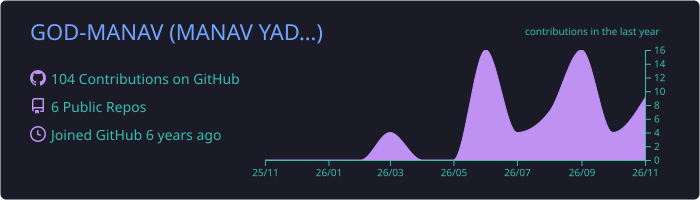
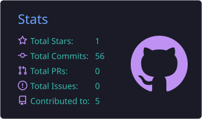
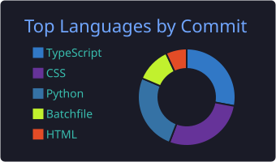

  

  

  
  
  

 

  

 

   
   
  

 

  
  
  
  
  

 

  

  
  

  

 

  <picture>
    <source media="(prefers-color-scheme: dark)" srcset="https://raw.githubusercontent.com/GOD-MANAV/GOD-MANAV/output/snake-dark.svg" />
    
  </picture>

  

